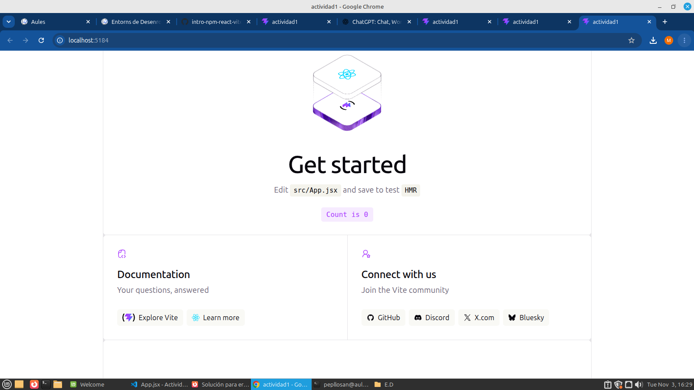
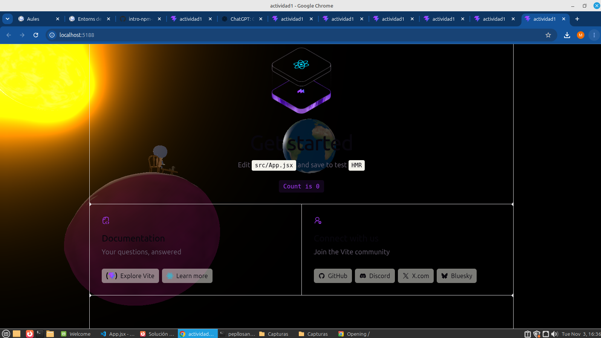

## Aqui tienes captura de la rama react-confetti

## Aqui tienes captura de la rama canvas-confetti

## Aqui tienes captura de la rama three

## Si la carpeta node_modules/ está excluida, ¿borrar una dependencia hace alguna acción sobre el repositorio? ¿Cuál?

> Sí, borrar una dependencia (por ejemplo, mediante un comando de desinstalación) sí modifica el repositorio a través de los archivos de configuración y control de versiones.

Aunque la carpeta node_modules/ esté excluida en el archivo .gitignore, los archivos que definen qué dependencias necesita el proyecto sí se versionan:

   - package.json: Se actualiza automáticamente para eliminar la librería de la sección de dependencias (dependencies o devDependencies).

   - package-lock.json (o el equivalente de tu gestor de paquetes): Se actualiza para reflejar que dicho paquete ya no forma parte del árbol de dependencias.